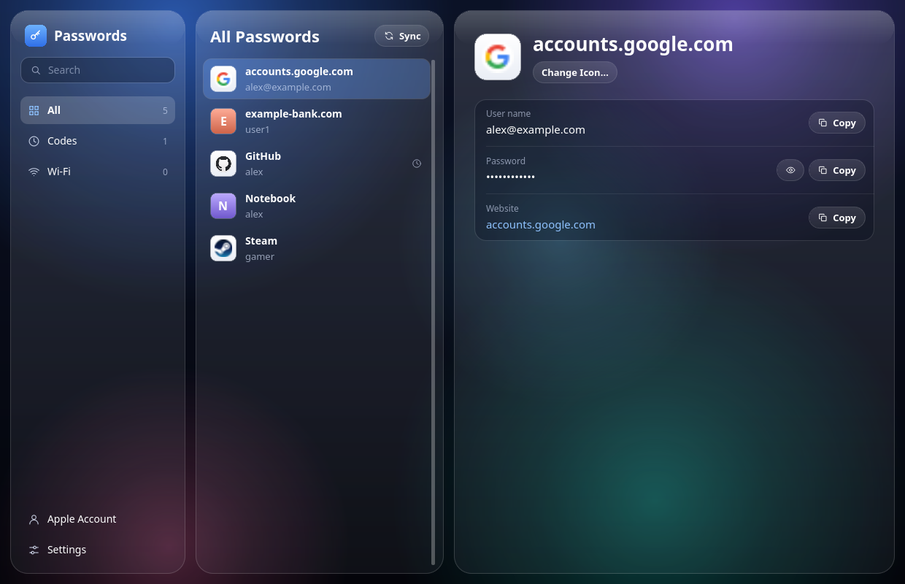
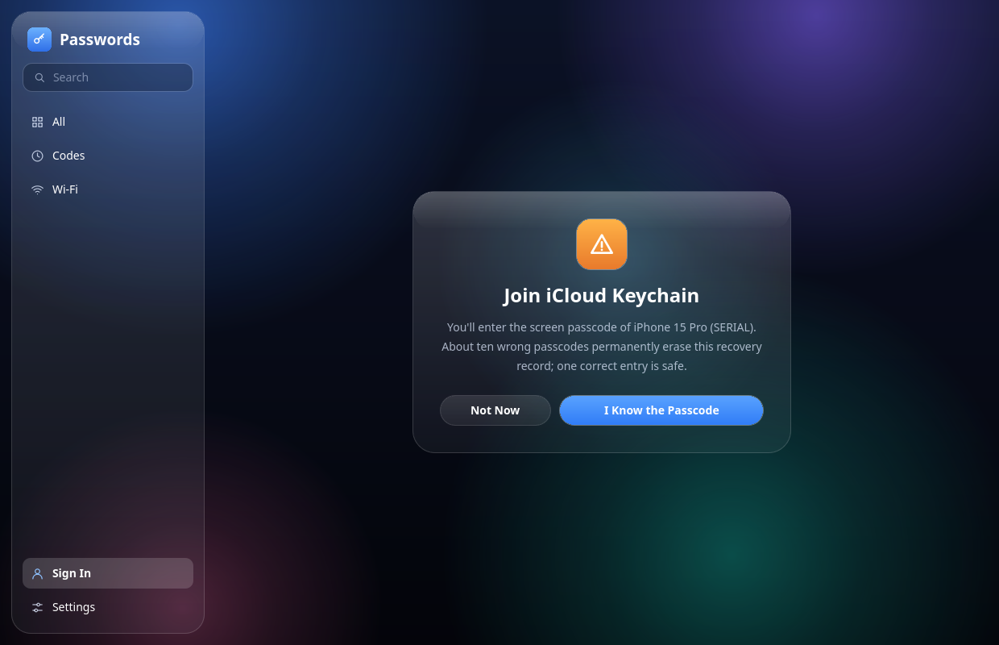
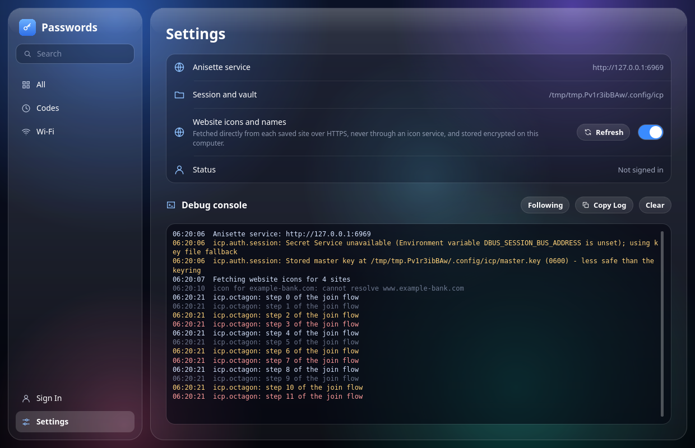

<p align="center">
  
</p>

<h1 align="center">iCloud Keychain for Linux UI</h1>

<p align="center">
  Tus contraseñas de iCloud en Linux, en una app de escritorio con estilo Liquid Glass.<br>
  Fork de <a href="https://github.com/Sank6/iCloud-Keychain-for-Linux">Sank6/iCloud-Keychain-for-Linux</a> que agrega una interfaz Qt Quick a su motor <code>icp</code>.
</p>

<p align="center"><a href="README.md">English</a> · <b>Español</b></p>

<p align="center">
  
</p>

Cliente **no oficial** del llavero de iCloud. Iniciás sesión con tu cuenta de Apple, la
computadora se registra como uno más de tus dispositivos Apple y descarga tus contraseñas a una
bóveda cifrada local. Una extensión del navegador las completa por vos, como la app Contraseñas
de un Mac o iPhone. Es un proyecto de ingeniería inversa y **no tiene relación con Apple**.

> No está probado con la Protección avanzada de datos activada. No abuses de los intentos de
> recuperación (código de desbloqueo).

## Descarga

Cada [release](../../releases) incluye `iCloud-Keychain-x86_64.AppImage`, que trae Python, Qt y
el motor:

```
chmod +x iCloud-Keychain-x86_64.AppImage
ICP_ANISETTE_URL=http://127.0.0.1:6969 ./iCloud-Keychain-x86_64.AppImage          # ventana
ICP_ANISETTE_URL=http://127.0.0.1:6969 ./iCloud-Keychain-x86_64.AppImage --cli status
```

**Sistemas compatibles:** Linux x86 de 64 bits con glibc 2.34 o más nuevo: Ubuntu 22.04+,
Debian 12+, Fedora 35+, Linux Mint 21+, Arch, Manjaro y openSUSE Tumbleweed. Alpine (musl) y
equipos ARM no son compatibles con el AppImage; ahí se usa desde el código fuente. La ventana
funciona en Wayland y en X11.

**Idiomas:** English, Español, Português, Français, Deutsch, Italiano, 中文（简体）, Русский y Українська. Usa el idioma del
sistema y, si no está disponible, inglés. Se cambia en Ajustes → Idioma.

## Qué necesitás: un servicio de anisette

**La forma fácil:** abrí la app. Si no hay un servicio de anisette respondiendo, aparece un
asistente que revisa las herramientas necesarias (y te muestra el único comando para instalarlas
en tu distribución), encuentra o te pide la carpeta `iCloud` de iCloud para Windows 15.10.39,
descarga la versión revisada de Anisette-on-Wine, la compila, registra la computadora con Apple e
inicia el servicio. Desde ahí la app lo inicia sola. En Ajustes → Servicio de anisette →
Configurar… se vuelve a abrir, y también acepta la dirección de un servicio que ya tengas.

**La forma manual:** ejecutá uno de estos y configurá `ICP_ANISETTE_URL`:

Apple identifica cada dispositivo con unos encabezados llamados *anisette*. Hace falta un
servicio que los genere:

- [Anisette-on-Wine](https://github.com/Sank6/Anisette-on-Wine): corre las librerías de iCloud
  para Windows en tu computadora con Wine. Es con el que se probó este fork. Necesita la carpeta
  `iCloud` de iCloud para Windows 15.10.39 (Microsoft Store), que no se puede redistribuir.
- [anisette-rs](https://github.com/Sank6/anisette-rs): nativo de Linux, recomendado por el
  proyecto original.
- [omnisette-server](https://github.com/SideStore/omnisette-server): usa librerías del APK de
  Apple Music para Android; se puede correr localmente (también con Docker).

**Qué ve ese servicio.** `icp` solo le hace dos pedidos `GET` vacíos y recibe encabezados del
dispositivo. Tu cuenta, tu contraseña, los códigos de verificación, el código de desbloqueo y tus
contraseñas **nunca** pasan por él: Apple verifica la contraseña con SRP y el llavero se
descifra en tu computadora. Un servidor remoto sí ve tu IP y cuándo iniciás sesión, y uno
malicioso podría darte una identidad rota; por eso conviene uno que corra en tu propia máquina.

```
export ICP_ANISETTE_URL="http://127.0.0.1:6969"
```

## Instalación desde el código

```
python3 -m venv .venv && .venv/bin/pip install -e '.[gui]'
.venv/bin/icp-gui        # ventana
.venv/bin/icp --help     # línea de comandos
```

## Usar la app

<p align="center">
  
  
</p>

1. **Cuenta:** correo y contraseña de tu cuenta de Apple.
2. **Código:** el código de seis dígitos que Apple muestra en tu iPhone, iPad o Mac. Solo se
   pide si esta computadora todavía no está verificada.
3. **Dispositivo:** elegí el dispositivo cuyo código de desbloqueo conocés.
4. **Código de desbloqueo:** el PIN o la contraseña con la que desbloqueás ese dispositivo. No es
   la contraseña de tu cuenta ni el código de seis dígitos. Cada error gasta uno de unos diez
   intentos; con el último, Apple borra para siempre ese registro de recuperación. Una entrada
   correcta es segura.

Después la bóveda se abre sola al iniciar la app y el botón redondo de **sincronizar** la
actualiza. En **Ajustes** están el idioma, los íconos de los sitios y una consola de depuración
que muestra cada paso del motor.

¿Preferís la terminal? Todo se puede hacer también con comandos `icp`: ver
[docs/CLI.md](docs/CLI.md) (en inglés).

## Íconos de los sitios

Los íconos y nombres se descargan **directamente de cada sitio** guardado (solo HTTPS con
certificado válido, solo direcciones públicas, con límite de tamaño), se vuelven a codificar como
PNG y se guardan cifrados en `~/.config/icp/icons` con nombres de archivo que no revelan los
sitios. Se cargan solo para las filas visibles. Podés apagarlo en Ajustes o poner un ícono a mano
con **Cambiar ícono…**.

## Extensión del navegador

La carpeta `extension/` funciona en navegadores Chromium y Firefox. Seguí la sección *Set up the browser extension* del
[README en inglés](README.md#browser-extension) y ejecutá `host/install.sh`.

## Seguridad

- La ventana no tiene acceso a la red propio; solo se conectan el motor y, si está activado, la
  descarga de íconos.
- Todo texto que viene de la bóveda se muestra como texto plano.
- Los archivos se crean solo legibles por vos (`umask 077`), no se generan volcados de memoria,
  el portapapeles se borra a los 30 segundos y las contraseñas reveladas se vuelven a ocultar a
  los 20 segundos.
- La consola de depuración enmascara tu cuenta y nunca registra contraseñas, códigos ni el código
  de desbloqueo.
- `icp` guarda tu contraseña de Apple cifrada para renovar la sesión sin pedirla. La llave queda
  en el llavero del sistema (GNOME Keyring o KWallet) o, si no hay, en `~/.config/icp/master.key`
  con permisos `0600`.

## Créditos

Basado en [Sank6/iCloud-Keychain-for-Linux](https://github.com/Sank6/iCloud-Keychain-for-Linux)
(MIT). Ver el [README en inglés](README.md#credits) para el detalle de créditos y licencias.
