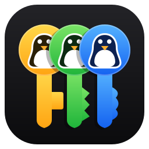
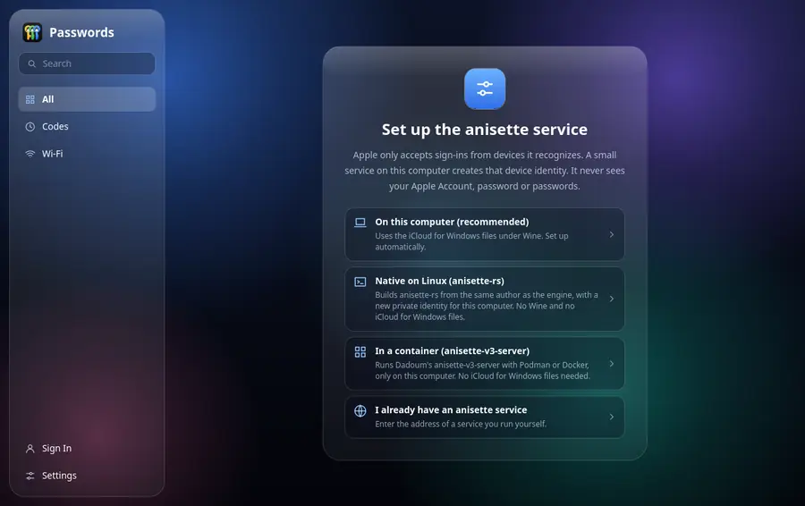

<p align="center">
  
</p>

<h1 align="center">iCloud Keychain for Linux UI</h1>

<p align="center">
  Your iCloud Passwords on Linux, in a Liquid Glass desktop app.<br>
  Sign in, join your keychain, and browse, copy and autofill your passwords, codes and Wi-Fi networks.<br>
  A fork of <a href="https://github.com/Sank6/iCloud-Keychain-for-Linux">Sank6/iCloud-Keychain-for-Linux</a> with a Qt Quick interface for its <code>icp</code> engine.
</p>

<p align="center">
  <a href="https://github.com/xXKuroiKenshiXx/iCloud-Keychain-for-Linux-UI/releases/latest"><b>Download</b></a> ·
  <a href="README.es.md"><b>Español</b></a>
</p>

<p align="center">
  <a href="docs/demo.mp4"></a>
</p>

<p align="center">
  <sub>Real recording of the app with made-up data · <a href="docs/demo.mp4">watch as MP4</a></sub>
</p>

**Unofficial** client for iCloud Keychain. Sign in with your Apple ID and
`icp` registers this computer as one of your Apple devices, then downloads your passwords into a
private, encrypted store on your machine. A browser extension fills them in for you, just like the
Passwords app on a Mac or iPhone. Your Hide My Email addresses show up too. This project is a
reverse engineering attempt and **is not affiliated with Apple in any way**.

> This is **untested** with Advanced Data Protection enabled. Any help with this will be appreciated -
> let me know if you have any issues with ADP enabled (also lmk if it works). Please don't spam escrow attempts!

## Download

Each [release](../../releases) ships an `iCloud-Keychain-x86_64.AppImage` that bundles Python,
Qt, and the engine:

```
chmod +x iCloud-Keychain-x86_64.AppImage
ICP_ANISETTE_URL=http://127.0.0.1:6969 ./iCloud-Keychain-x86_64.AppImage          # window
ICP_ANISETTE_URL=http://127.0.0.1:6969 ./iCloud-Keychain-x86_64.AppImage --cli status
```

Open it and it offers to add itself to your applications menu (it copies itself to
`~/Applications` and adds a menu entry with its icon; Settings can remove it again). You also
need an anisette service. On first launch the app offers to set one up for you (next section); Apple's libraries cannot be redistributed, so you point it at the `iCloud` folder of iCloud for Windows.

**Supported systems:** 64-bit x86 Linux with glibc 2.34 or newer, which covers Ubuntu 22.04+,
Debian 12+, Fedora 35+, Linux Mint 21+, Arch, Manjaro, and openSUSE Tumbleweed. Alpine (musl)
and ARM machines are not supported by the AppImage; run from source there. The window uses
Wayland or X11.

**Languages:** English, Español, Português, Français, Deutsch, Italiano, 中文（简体）, Русский, and Українська. The window follows
the system language and falls back to English; change it under Settings → Language.

## What you'll need

**The easy way:** open the app. When no anisette service answers, it opens a setup assistant
that checks the tools it needs (and shows the one install command for your distribution),
finds or asks for the `iCloud` folder from iCloud for Windows 15.10.39, downloads the reviewed
version of Anisette-on-Wine, builds it, registers this computer with Apple, and starts the
service. It can instead build **anisette-rs** natively (a pinned commit, Rust installed through
rustup when needed, and a fresh random Windows identity kept private on this computer) or run
**anisette-v3-server** in Podman or Docker (pinned by digest, bound to localhost). From then on
the app starts the service by itself. Settings → Anisette service → Set Up…
opens the assistant again, and it also accepts the address of a service you already run.

**The manual way:** run one of these yourself and set `ICP_ANISETTE_URL`:

A configured Anisette server:

- [anisette-rs](https://github.com/Sank6/anisette-rs) (**recommended**) runs natively on Linux -
  uses Windows iCloud headers.
- [Anisette-on-Wine](https://github.com/Sank6/Anisette-on-Wine) runs the Windows iCloud
  libraries locally under Wine.
- [omnisette-server](https://github.com/SideStore/omnisette-server) runs locally on Linux
  (including via Docker) using libraries from the Android Apple Music APK, and can also be
  hosted on a remote server.

You can also use any trusted third-party anisette server.

**What the anisette server sees.** `icp` only sends it two empty `GET` requests and receives
device headers back. Your Apple Account, password, verification codes, device passcode, and
passwords never go to it: the password is checked by Apple with SRP and the keychain is
decrypted on your computer. A remote server still learns your IP address and when you sign
in, and a malicious one could hand out a broken identity, so prefer one that runs on your own
machine. This fork was tested with Anisette-on-Wine, which listens only on `127.0.0.1` and
talks only to `gsa.apple.com`.

```
export ICP_ANISETTE_URL="https://your-anisette-server.example"
```

The configured URL must return anisette headers as JSON to a `GET` request. Its
`/v3/client_info` endpoint must return `client_info` and `user_agent`.

## Using the app


Open the AppImage (or `icp-gui` from source) and go to **Apple Account**:

1. **Account:** your Apple Account email and password.
2. **Code:** the six-digit code Apple shows on your iPhone, iPad or Mac. It is only asked when
   this computer is not verified yet.
3. **Device:** pick the device whose screen passcode you know.
4. **Passcode:** the passcode you use to unlock that device, not your Apple Account password
   and not the six-digit code. Each wrong passcode uses one of about ten recovery attempts;
   after the last one Apple permanently erases that recovery record. One correct entry is safe.

**Sign Out…** in Apple Account either keeps this computer in your keychain (the next sign-in
only needs your Apple Account password) or removes it completely (the next sign-in asks for a
device passcode again). Wi-Fi networks show a QR code another phone can scan to join.

After that the vault opens on start, the round **Sync** button refreshes it, and the window
also signs in again by itself when the iCloud session expires. **Settings** has the language,
website icons, and a debug console that shows each engine step as it happens.

**Website icons and names** are fetched directly from each saved site (HTTPS only, public
addresses only, size-limited, re-encoded as PNG) for the rows you are looking at, and kept in
an encrypted cache under `~/.config/icp/icons` whose file names do not reveal the sites. Turn
this off in Settings to keep the window fully offline, or set any login's icon by hand with
**Change Icon…**.

The toolbar above the list sorts by website, title, date edited, or date created (ascending or
descending), and its **More** menu generates a strong password (`xxxxxx-xxxxxx-xxxxxx`, from a
cryptographic random source) or exports every password to a CSV in the same columns Apple
uses (Title, URL, Username, Password, Notes, OTPAuth; the file is created readable only by
you). The sidebar can be full or compact and hidden with the toolbar button, the appearance
follows the system or stays light or dark, and Settings can turn off all animations and
effects. Adding, editing, deleting, and importing passwords are not available yet: the
engine only reads the keychain.

Prefer the terminal? Every step is also available as an `icp` command: see
[docs/CLI.md](docs/CLI.md).

## Run from source

```
python3 -m venv .venv && .venv/bin/pip install -e '.[gui]'
.venv/bin/icp-gui        # window
.venv/bin/icp --help     # command line
```

On distributions that package PyQt6 (`python3-pyqt6`), create the venv with
`--system-site-packages` and install `-e .` instead. `icp-gui --classic` opens the earlier Qt
Widgets window.

## Browser extension

The `extension/` folder works in Chromium based browsers and Firefox.

### Chrome, Chromium, Helium, or Brave

1. Open your browser's extensions page (e.g. `chrome://extensions`, `helium://extensions`) and turn on **Developer
   mode**.
2. Click **Load unpacked** and choose the `extension/` folder. Copy the **Extension ID** it shows.
3. Connect the extension to `icp` by running:

   ```
   host/install.sh <EXTENSION_ID>
   ```

4. Reload the extension. Click its toolbar icon - you'll see the logins for the current site.

### Firefox

1. Open `about:debugging#/runtime/this-firefox`, click **Load Temporary Add-on...**, and choose
   `extension/manifest.json`. (Firefox removes temporary add-ons when it restarts, so you'll need
   to re-load it after restarting.)
2. Connect it to `icp`:

   ```
   host/install.sh
   ```

3. Click the toolbar icon to see logins for the current site.

If you ever move this project to a different folder, just run `host/install.sh` again.

### Filling in passwords

- On a sign-in page, click the username or password box - an **iCloud Passwords** dropdown appears
  with matching logins. Click one to fill it in (it handles email-first pages like Google too).
- Start typing to narrow the list.
- Or click the extension's toolbar icon and pick a login there.
- On a **two-factor code** box, the dropdown offers the current code instead - click to fill it.
  Pages that split the code across six separate boxes are filled a digit at a time. The code is
  always regenerated at the moment you click, so it is never a stale one, and the toolbar popup
  shows the code next to each login (click it to copy).

## Security notes for the desktop app

- The window has no network access of its own; only the engine and the optional icon fetcher
  connect, and the icon fetcher talks only to each saved site over verified HTTPS.
- Every string from the vault is rendered as plain text, never as rich text.
- Files are created with a `077` umask, core dumps are disabled while the window runs, the
  clipboard is cleared 30 seconds after a copy, and revealed passwords hide again after 20
  seconds.
- The debug console masks the Apple Account and records engine messages from INFO upward;
  passwords, codes, and passcodes are never logged.

## Credits

The GrandSlam sign-in flow is adapted from [JJTech's reference](https://gist.github.com/JJTech0130/049716196f5f1751b8944d93e73d3452).
The keychain decryption, Octagon trust join, and CloudKit transport follow
[OpenBubbles/rustpush](https://github.com/OpenBubbles/rustpush), cross-checked against
[Apple's open-source Security code](https://github.com/apple-oss-distributions/Security). Hide My
Email is ported from [dedoussis's browser extension](https://github.com/dedoussis/icloud-hide-my-email-browser-extension).
Machine data is provided by the configured anisette server. See `RESEARCH.md` for protocol details.
